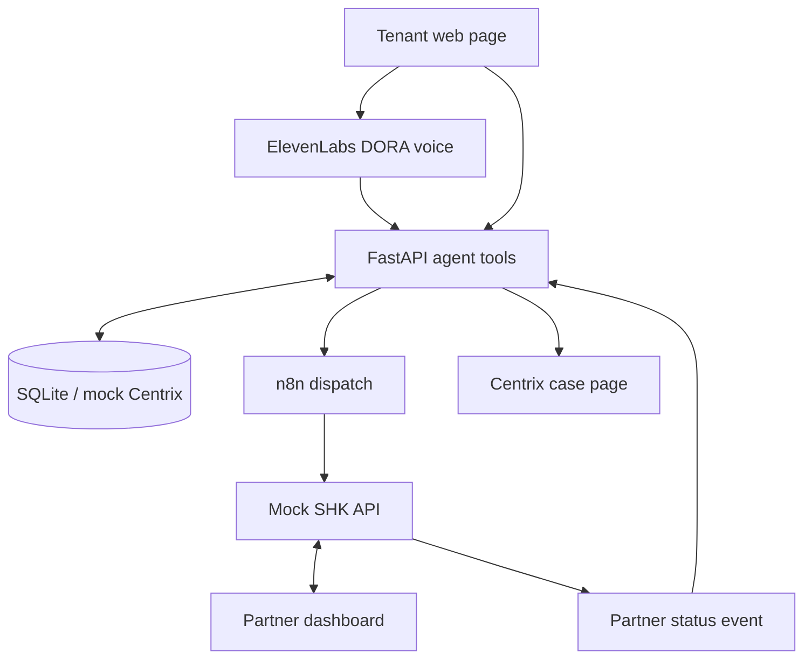

# Architecture and boundaries

One website at `/tenant`, `/partner`, `/centrix` served by FastAPI. The website and voice agent do not own business state. SQLite represents mock Centrix. n8n coordinates external job dispatch after P0 backend/partner contract is stable.

## Domain assumptions
- Heating is central in a six-unit apartment building, but we are not modeling fluid circuits, boiler diagnosis, or arbitrary landlord billing allocation.
- Resident reports \"my heating isn't working\". SHK technician decides fault and repairs.
- Building has ONE contracted, authorized SHK partner. Partner available slots are simulated.
- Standard initial visit is preauthorized by the property manager; bigger work/charges would escalate in a real implementation.
- Provider's report and invoice are attached to Centrix record. No payment processing.
- Basic safety checks exist; emergency gas hazard routing is not part of pitch.

## State ownership
**Backend:** reported, awaiting_partner, scheduled, in_progress, completed, needs_attention. **Partner:** received, accepted, in_progress, completed, rejected. Frontend displays only. LLM suggests tool actions, never writes status itself.

## Planned availability matching

After the local flow works, FastAPI can compare Google Calendar free/busy with provider windows and give DORA the earliest common one-hour appointment. The tenant approves the proposed time before dispatch. The provider receives the approved request and confirms it by accepting the slot. Phone calendar access is planned. Person 3 owns the proposal operation and new case fields (TBD).

## Async conversation
Tenant authorizes a booking window. DORA can end call after sending the request, notify via UI/status when confirmed, and resume conversation if needed. No waiting on a live speech session for an external contractor.

## Integration and fallback
The initial scaffold may call mock partner logic directly in-process. Transition n8n into the actual dispatch path before claiming n8n as an implemented integration. All real callbacks and internet-exposed tool routes must have auth and idempotency.
